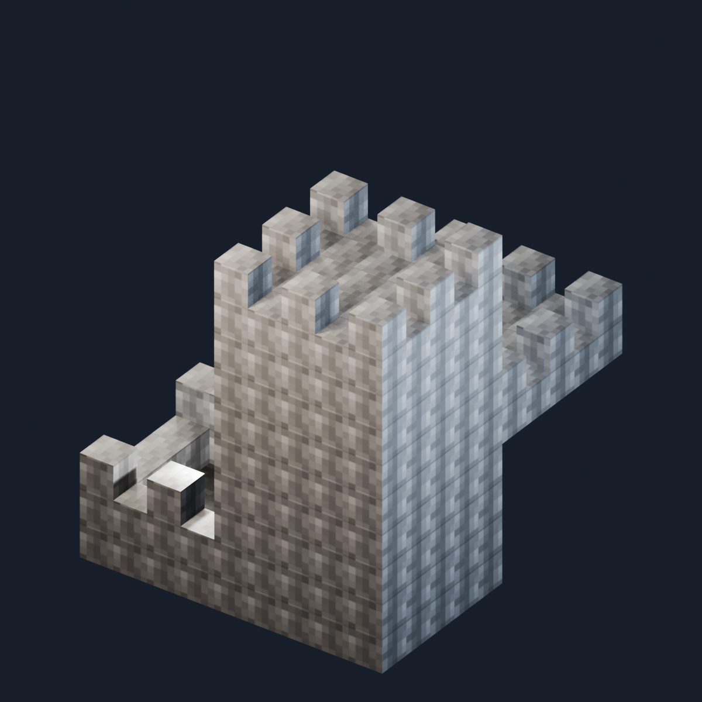

# Blender — коллекция проектов

Здесь хранятся мои проекты Blender. Каждый проект находится в своей папке внутри `projects/`, со сценой, изображениями и описанием.

## Проекты

| Проект | Описание | Сцена |
|---|---|---|
| [Замок из блоков](projects/castle/) | Каменный замок в блочном стиле Minecraft | [04.blend](projects/castle/04.blend) |

## Как добавить проект

1. Скопируй папку [templates/project](templates/project/) в `projects/название-проекта/`.
2. Дай папке короткое имя латиницей, например `cozy-room` или `low-poly-tree`.
3. Сохрани сцену `.blend` в корне папки проекта, текстуры — в `textures/`, изображения — в `screenshots/`.
4. Заполни README проекта: описание, имя сцены, версию Blender и способ открытия.
5. Добавь ссылку на проект в таблицу выше и отправь изменения в GitHub.

Пустые папки в шаблоне содержат `.gitkeep`; после добавления файлов эти заглушки можно удалить.

## Правила хранения

- Один проект — одна папка. Внутри проектов отдельный `git init` не нужен.
- `textures/` — нужные внешние текстуры; `screenshots/` — выбранные изображения для галереи; `exports/` — готовые модели для других программ, если нужны.
- Резервные копии Blender, временные файлы, кэши и папки `renders/` исключены из Git. Для публикации выбранного рендера сохрани его в `screenshots/`.
- Перед переносом сцены упакуй внешние ресурсы в Blender через **File → External Data → Pack Resources** либо используй относительные пути к файлам внутри папки проекта.
- Название репозитория остаётся Blender: его удобно клонировать как общую папку со всеми работами.
- Если отдельный проект станет очень большим или потребует своей команды и доступа, его можно будет вынести в отдельный репозиторий, оставив здесь ссылку.
- Для крупных двоичных файлов при росте коллекции можно отдельно настроить Git LFS; сейчас LFS не подключён.

Лицензии указываются отдельно в описании каждого проекта.
