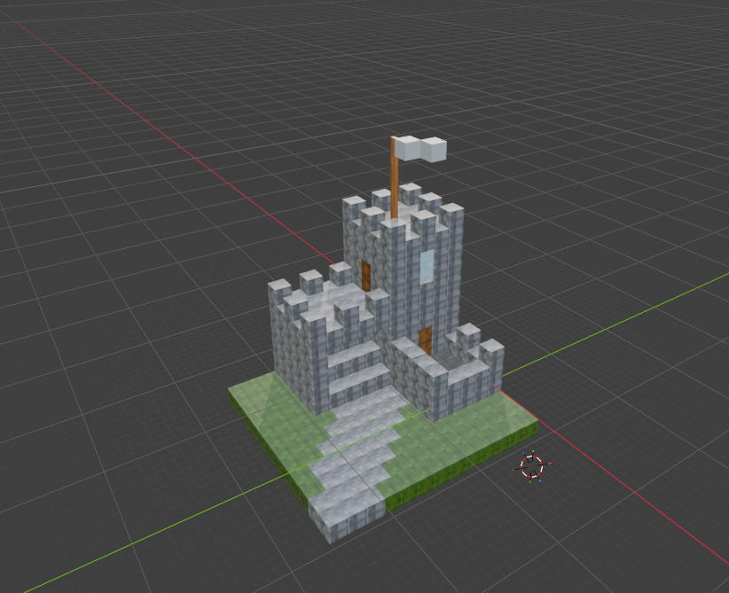
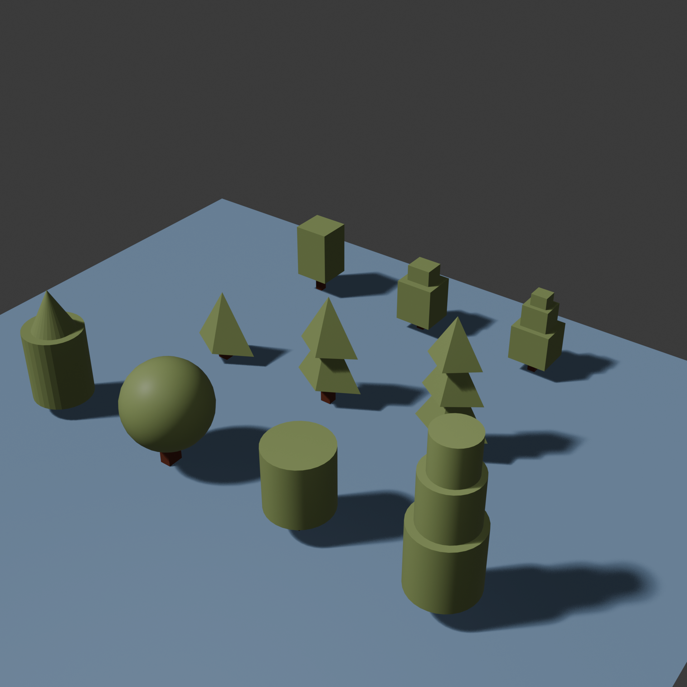

# Blender

Мои проекты в Blender: модели, сцены и результаты работы. У каждого проекта своя папка с файлом Blender, скринами и описанием.

## Проекты

### [Замок](Замок/)

Каменный замок из блоков в стиле Minecraft: стены с зубцами и центральная башня.

[Открыть проект и все скрины →](Замок/)

### [Деревья из примитивов](Деревья_2/)

Низкополигональная сцена Blender: 10 геометрических деревьев из простых форм, с настроенными камерой и освещением.

[Описание, файлы и ZIP-архив →](Деревья_2/)

