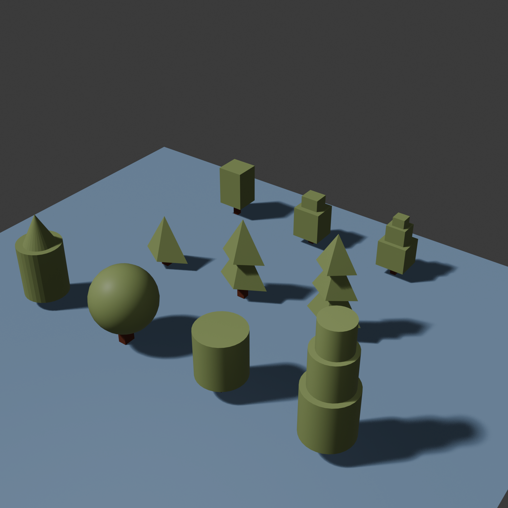

# Деревья из примитивов

Низкополигональная сцена Blender с геометрическими деревьями, собранными из простых форм. Модели сгруппированы по типу в ровные ряды; для сцены настроены камера и освещение. Исходные формы и цвета материалов сохранены.

## Основной файл

- [Untitled6.blend](Untitled6.blend) — актуальная сцена с выставленными фигурами, камерой и светом.
- [финальный вид-деревья.blend](финальный%20вид-деревья.blend) — дополнительная сохранённая версия проекта.
- Untitled.blend–Untitled5.blend — промежуточные версии.
- [Деревья_2.zip](Деревья_2.zip) — архив исходной папки с файлами проекта и референсами.

## Состав

- 10 фигур из примитивов с зелёными кронами и коричневыми стволами.
- 3 изображения-референса в папке «Референсы - Растения из примитивов».
- Финальный PNG-рендер в папке «Скриншоты».
