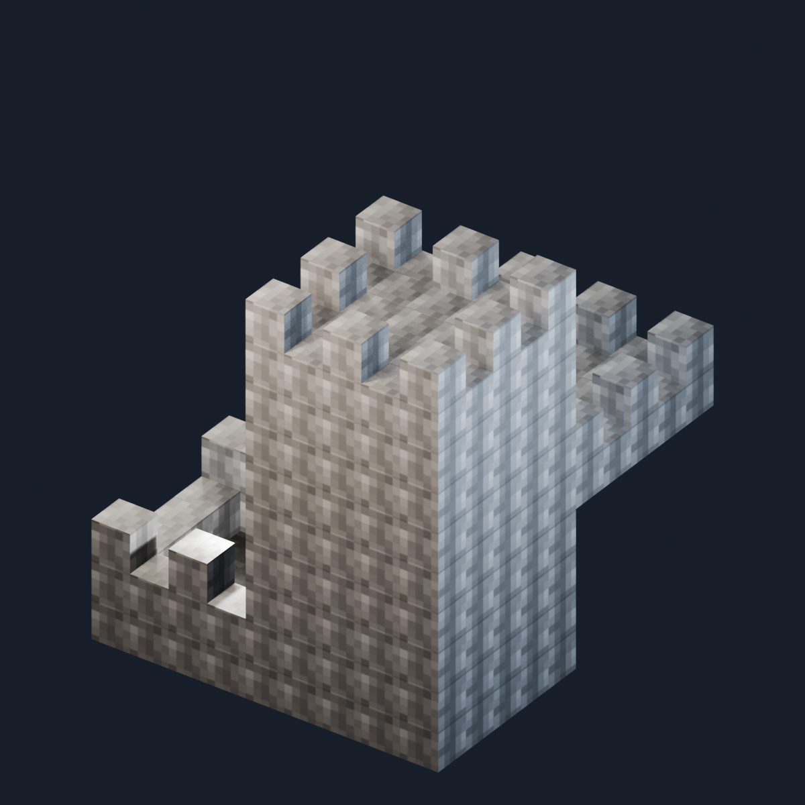
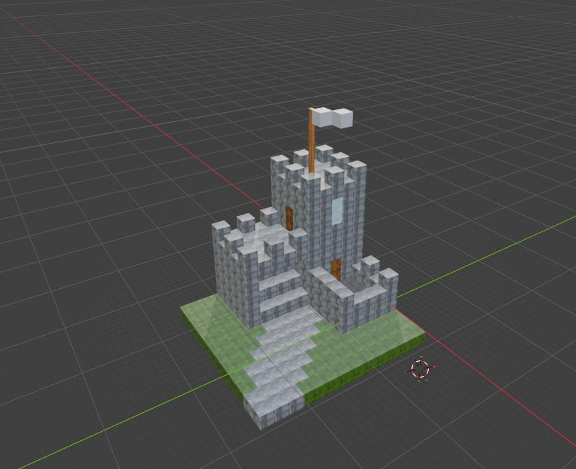
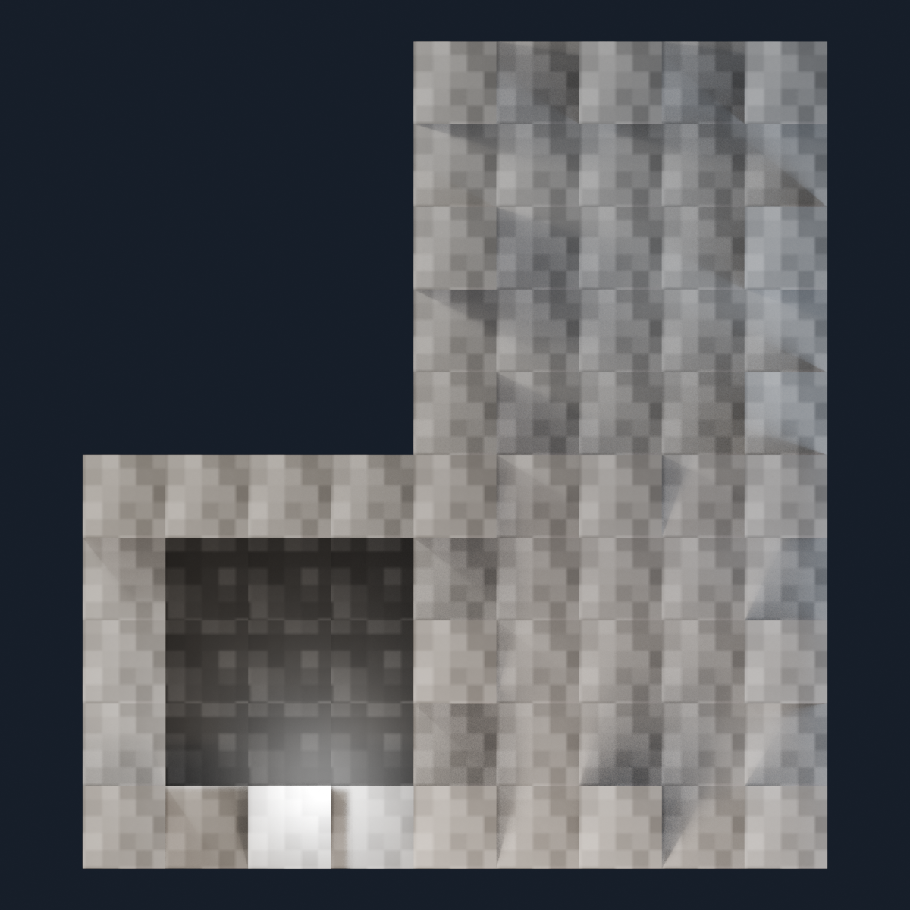
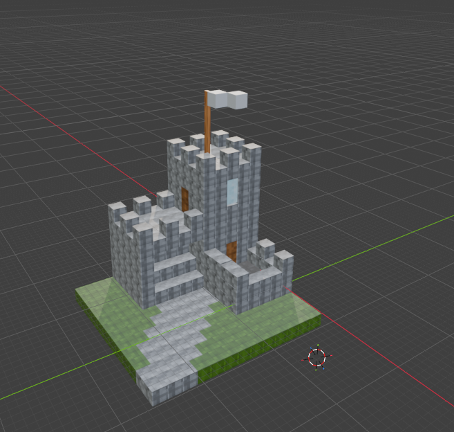

# Замок

3D-сцена каменного замка в блочном стиле Minecraft. Замок собран из кубов: зубчатые стены, центральная башня и пиксельные каменные текстуры.

**[Скачать файл проекта — Замок.blend](Замок.blend)** · **[Все скрины](Скрины/)** · **[Все проекты](../README.md)**

## Как открыть

Скачай `Замок.blend` и открой его в Blender. В описании исходного проекта указаны Blender 5.3.0 и рендер EEVEE; текстуры упакованы в сцену. Для рендера с настроенной камеры нажми **F12**.

## Как получилось

### Общий вид

### Фасад

### Вид сверху

### Скриншоты работы

## О модели

Сцена содержит 234 объекта-меша. Блоки размером 2 × 2 × 2 м выровнены по сетке с шагом 2 м. В опубликованной сцене настроены камера и свет.

Отдельные файлы референсов в репозитории не добавлены.
